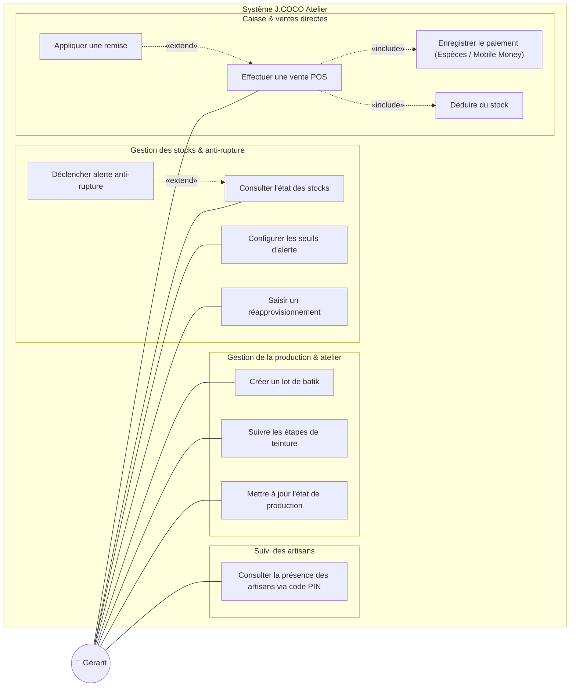
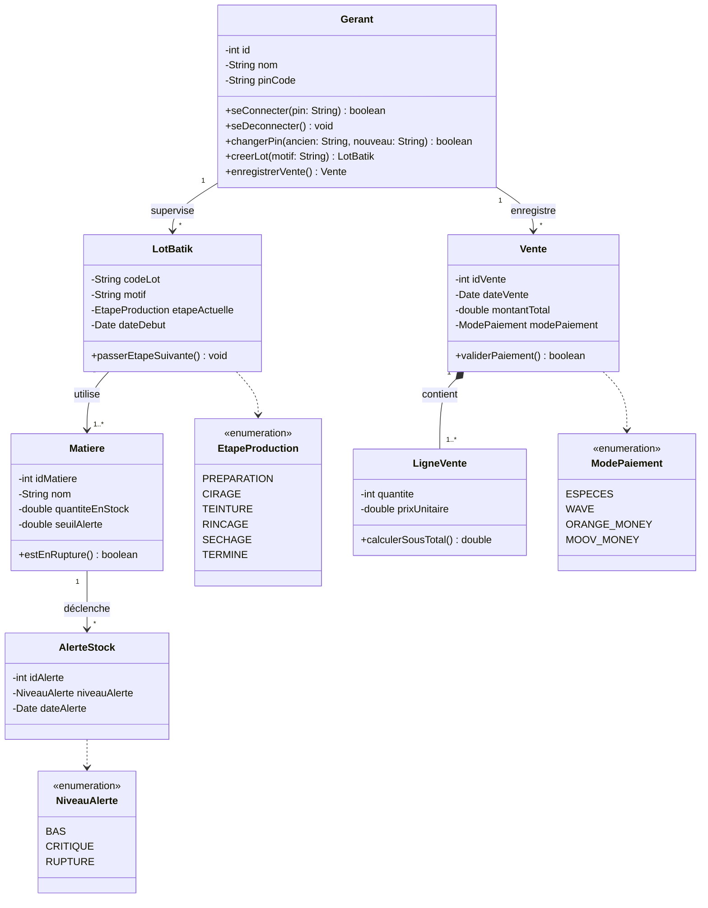
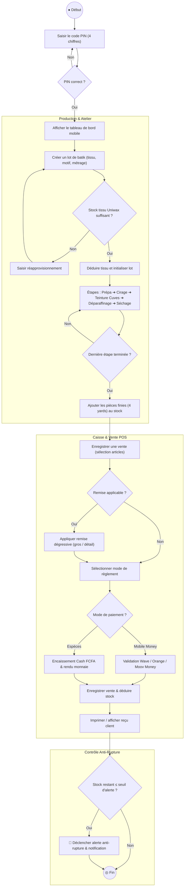
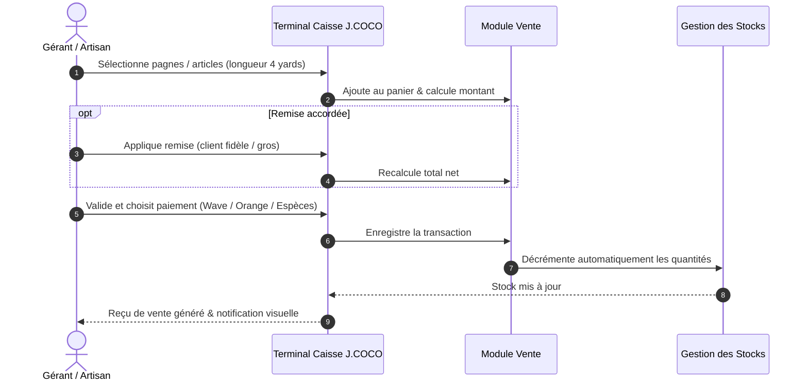
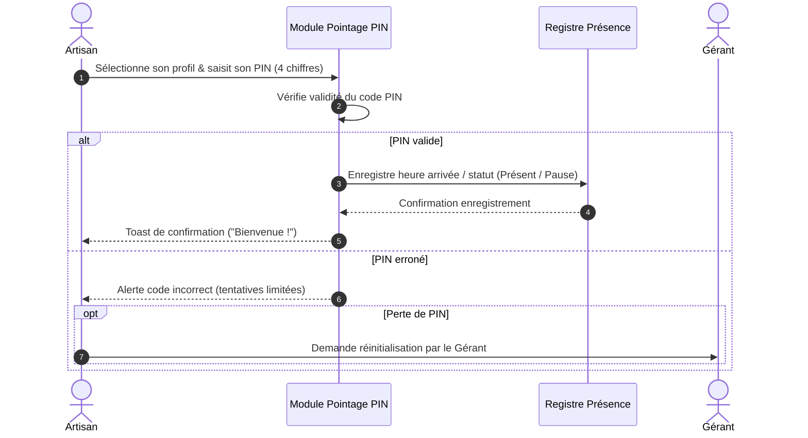
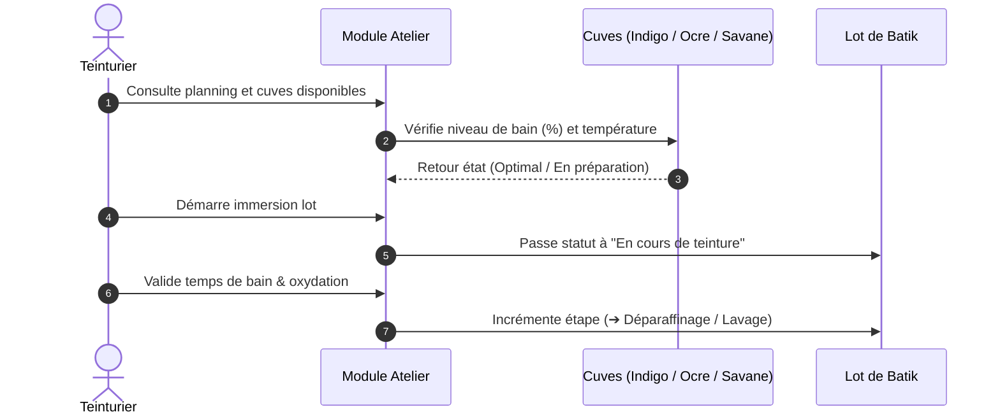
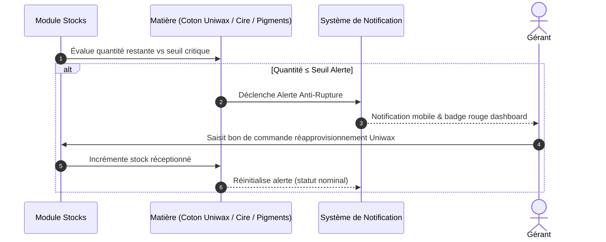

# 🧵 J.COCO Atelier Batik – Application mobile de gestion

Projet réalisé dans le cadre du module **Atelier de Génie Logiciel** (domaine n°28 : industrie textile), Licence 3 Génie Logiciel, **Institut Ivoirien de Technologie (IIT)**.

**Auteur :** Touré Lamine · **Année académique :** 2026-2027

---

## Sommaire

1. [Présentation de l'entreprise](#1-présentation-de-lentreprise)
2. [Présentation du projet](#2-présentation-du-projet)
3. [Modélisation & Diagrammes UML](#3-modélisation--diagrammes-uml)
   - [3.1 Diagramme des cas d'utilisation](#31-diagramme-des-cas-dutilisation)
   - [3.2 Diagramme de classes métier](#32-diagramme-de-classes-métier)
   - [3.3 Diagramme d'activité global](#33-diagramme-dactivité-global)
   - [3.4 Diagrammes de séquence](#34-diagrammes-de-séquence)

---

# 1. Présentation de l'entreprise

## 1.1 Identité

| Rubrique | Information |
| :--- | :--- |
| Nom de la structure | J.COCO Atelier Batik (CI) |
| Secteur d'activité | Industrie textile, artisanat d'art et confection semi-industrielle |
| Localisation | Centre Artisanal de Grand-Bassam, Côte d'Ivoire |
| Canaux de vente | Modèle hybride : vente en gros (grossistes) et vente directe (au détail) |
| Partenariats | Collaborations avec des structures et maisons de mode professionnelles ; ambition de développer ces partenariats |

## 1.2 Vision et positionnement

J.COCO se distingue par une double identité sur le marché artisanal à Bassam. Le promoteur souhaite que sa structure soit pleinement reconnue à la fois comme :

1. **Un producteur** : un atelier technique maîtrisant la teinture artisanale et semi-industrielle (technique du batik).
2. **Un vendeur** : un distributeur textile capable de fournir le marché local et les créateurs de mode.

## 1.3 Processus opérationnel et cycle de production

- **Approvisionnement :** la matière première principale (tissu brut en coton ou pagne blanc) provient d'**Uniwax**, leader industriel national.
- **Activité technique :** l'atelier applique la cire chaude, trace les motifs et réalise des bains de teinture successifs pour créer des pièces uniques ou des séries.
- **Standard du marché :** la production est calibrée sur le format **4 yards**, taille de coupe la plus demandée et la plus vendue de l'atelier.
- **Saisonnalité :** l'activité est fortement cyclique ; le pic de production se concentre sur la saison de **janvier à juin**.

## 1.4 Problématiques de l'entreprise

L'analyse de l'activité de J.COCO met en évidence quatre difficultés organisationnelles.

### 1. Les ruptures de stock récurrentes (problème principal)

L'atelier subit des interruptions de production et des pertes de ventes à cause d'une mauvaise visibilité sur ses stocks. Les ruptures concernent deux niveaux :

- **En amont (intrants) :** manque de réactivité sur l'achat des tissus blancs chez Uniwax et des consommables de teinture (cires, pigments).
- **En aval (produits finis) :** difficulté à satisfaire la demande immédiate sur le format phare de 4 yards, faute d'alerte de seuil critique.

### 2. La complexité de la gestion hybride et des tarifs

Le client doit jongler manuellement entre les commandes des grossistes, les ventes au détail et les réservations des structures de mode. Sans outil centralisé, l'application des grilles tarifaires différenciées et le suivi des stocks promis aux partenaires peuvent générer des erreurs.

### 3. La pression logistique saisonnière (janvier à juin)

Pendant la haute saison, le volume de tissu à traiter augmente fortement. Sans suivi des étapes de teinture (cirage, bain, séchage), l'atelier peine à planifier sa charge de travail, ce qui met en risque les délais de livraison des collections des structures de mode partenaires.

### 4. Le déficit de visibilité statistique

Pour asseoir sa notoriété de « producteur-vendeur », l'entreprise manque de données chiffrées centralisées. Elle ne peut pas mesurer précisément la part de sa production absorbée par les grossistes par rapport au détail, ni évaluer la performance de son atelier à l'issue de la haute saison.

---

# 2. Présentation du projet

## 2.1 Contexte et périmètre

Le client ne dispose pas d'ordinateur : la gestion de l'atelier doit se faire entièrement **sur smartphone**. Il souhaite aussi gagner en visibilité et recevoir plus de demandes de collaboration, au-delà de ses collaborations actuelles avec des groupes de dames de l'église.

Le projet comprend deux parties distinctes, étroitement liées :

| Partie | Description |
| :--- | :--- |
| **Application mobile de gestion** (Flutter) | Cœur du projet. Réservée à l'équipe de l'atelier, elle fonctionne **hors ligne, sur le téléphone**, sans serveur. |
| **Site web vitrine** | Site de présentation simple, modifié **à la demande du client**. Il n'est pas alimenté par l'application. Son déploiement est une partie tierce, séparée de l'application, qui y renvoie par un lien. |

## 2.2 Objectifs

1. Réduire les ruptures de stock (tissu Uniwax, intrants de teinture, pièces finies en 4 yards).
2. Suivre la production de teinture, en particulier de janvier à juin.
3. Enregistrer les ventes en gros et au détail, avec le tarif correspondant.
4. Augmenter la visibilité de l'atelier grâce à un site vitrine et faciliter les demandes de collaboration.

## 2.3 Besoins exprimés par le client

| Thème | Besoin |
| :--- | :--- |
| Matériel | Pas d'ordinateur portable : solution mobile |
| Positionnement | Être connu en tant que producteur et vendeur |
| Visibilité | Plus de visibilité et plus de demandes de collaboration, au-delà des collaborations actuelles |
| Canaux de vente | Grossistes et vente au détail |
| Produit phare | Format 4 yards, taille la plus demandée |
| Fournisseur | Tissu acheté chez Uniwax |
| Production | Teinture ; saison de janvier à juin |
| Partenariats | Ambition de collaborer avec des structures de mode |
| Problème principal | Les ruptures de stock |
| Déploiement | Possibilité de déployer l'application |

> Les fonctionnalités, rôles et choix techniques ci-dessous sont des propositions de l'auteur, présentées dans la maquette de l'application.

## 2.4 Fonctionnalités de l'application mobile

### Accès sécurisé de l'équipe
- Écran de démarrage, puis connexion par **code PIN à 4 chiffres** et choix du profil (responsable ou artisan).
- **Inscription d'un nouvel artisan** (nom, WhatsApp, spécialité, PIN), validée par le responsable.
- **Récupération du PIN** hors ligne : clé de secours ou questions secrètes, avec limite de tentatives.

### Stocks et alertes anti-rupture
- Deux vues : **matières premières** (tissu brut Uniwax, cires, pigments) et **produits finis** (format 4 yards).
- Seuil d'alerte par article ; état du stock (confortable, seuil bas, rupture).
- Enregistrement de l'entrée d'un rouleau (métrage en yards, fournisseur), avec scan de QR code.
- **Alertes de rupture** sur le tableau de bord et notifications sur le téléphone.

### Suivi de l'atelier et de la production
- **Pipeline en 5 étapes** par lot : `Prépa` → `Cirage` → `Cuves (teinture)` → `Séchage` → `Fini`.
- Suivi des lots en cours (motif, responsable, commande associée) et passage à l'étape suivante.
- **État des cuves** (indigo, terracotta, ocre) : en cours, en préparation, disponible.
- **Haute saison (janvier à juin)** : objectif de production et taux de complétion.
- Historique des recettes de teinture.

### Ventes et partenaires
- **Caisse et ventes directes** : choix de la longueur (2, 4 ou 6 yards, rouleau), de la pièce et de la quantité.
- **Tarif gros et tarif détail**, avec une remise dégressive proposée (à valider avec le client).
- Enregistrement du mode de paiement : espèces, Wave, Orange Money ou Moov Money.
- **Décrémentation automatique du stock** à chaque vente.
- **Commandes et partenaires** : suivi des demandes des structures de mode, avec réponse directe par WhatsApp.
- Recette du jour, répartition grossistes et détail.

### Tableau de bord
- Alertes anti-rupture, lots en cours, pièces prêtes, commandes et partenaires, atelier découverte à venir.
- Actions rapides : nouveau lot, vente rapide, accès à la vitrine.

### Onglet Vitrine
- Lien du site web, bouton pour le visiter et pour le partager.

## 2.5 Site web vitrine

Site de présentation, modifié à la demande du client. Contenu proposé :

- présentation de l'atelier et de son double statut de producteur et de vendeur ;
- galerie de photos des réalisations ;
- information sur les ateliers ;
- **contact WhatsApp** de J.COCO atelier Batik, utilisé aussi pour les rendez-vous, les commandes en gros et les demandes de collaboration.

## 2.6 Acteurs et droits

| Acteur | Accès |
| :--- | :--- |
| **Responsable de l'atelier** | Accès complet à l'application ; valide l'inscription des artisans |
| **Artisan** (cuves, cirage, stocks, apprenti) | Accès à l'application selon sa spécialité |
| **Visiteur / client potentiel / partenaire** | Site vitrine uniquement ; contact par WhatsApp |

## 2.7 Choix techniques

- **Application :** Flutter, Android en priorité.
- **Données :** stockage local (SQLite ou Hive), sans serveur.
- **Notifications :** alertes de rupture locales, calculées sur le téléphone.
- **Sécurité :** PIN et clés chiffrés dans l'espace sécurisé du téléphone (Keystore / Keychain).
- **Sauvegarde :** export manuel des données (à prévoir, pour éviter la perte en cas de téléphone perdu ou cassé).
- **Paiements :** le mode de paiement est enregistré, sans intégration des services de mobile money.
- **Site vitrine :** site simple, hébergé séparément (nom de domaine à définir).

## 2.8 Livrables

- [x] Cahier des charges (v1.0, à mettre à jour en v1.1)
- [x] Maquette de l'application (Google Stitch)
- [x] Diagrammes  (UML)
- [x] Maqquette Figma
- [ ] Prototype de l'application Flutter
- [ ] Site vitrine

---

# 3. Modélisation & Diagrammes UML

Les diagrammes ci-dessous modélisent fidèlement l'architecture technique, les cas d'utilisation et les flux opérationnels de l'application mobile **J.COCO Atelier Batik**.

---

## 3.1 Diagramme des cas d'utilisation

---

## 3.2 Diagramme de classes métier

---

## 3.3 Diagramme d'activité global

---

## 3.4 Diagrammes de séquence

### 3.4.1 Caisse & Ventes directes (POS)

### 3.4.2 Pointage des artisans par code PIN

### 3.4.3 Suivi atelier & cuves de teinture

### 3.4.4 Gestion des stocks & alertes anti-rupture

---

LIEN DE LA MAQUETTE FIGMA:
(https://www.figma.com/design/iIXCN4j3ygmRA6B2eDSrCj/Dynamic-J-COCO-APP?m=auto&t=QSytUqpfnUrbucIh-6)

**Touré Lamine** – Licence 3 Génie Logiciel, Institut Ivoirien de Technologie (IIT)
